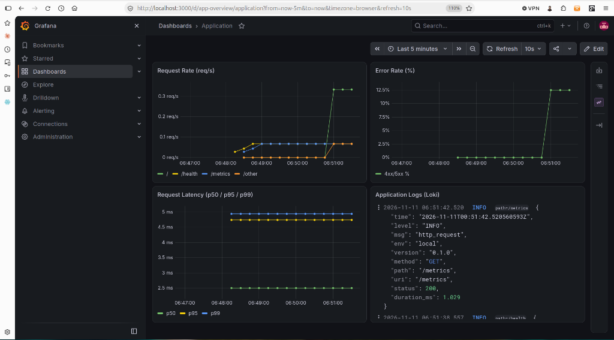
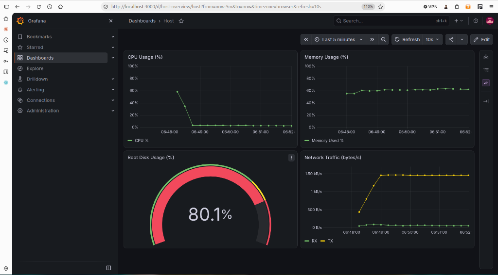
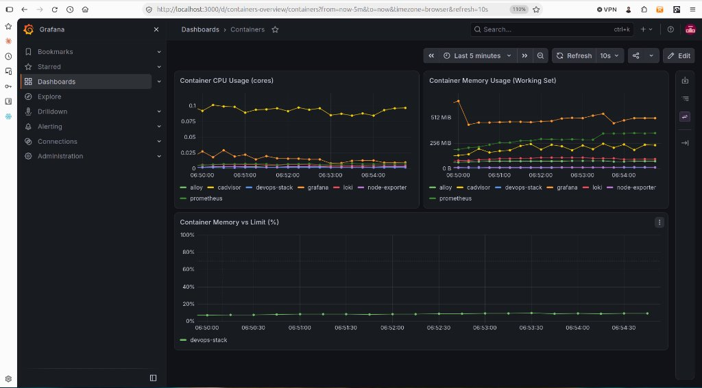

# devops-stack

Go HTTP service with Prometheus metrics, structured JSON logs, containerized local setup, and an observability stack.

## Run Locally

Requires Docker and Docker Compose (Go 1.26+ optional for running tests directly).

### App Only

```bash
docker compose up -d --build
curl -s http://localhost:8080/
curl -s http://localhost:8080/health
curl -s http://localhost:8080/metrics | head -n 20
docker compose down
```

### Full Observability Stack

```bash
cp .env.example .env   # set GRAFANA_ADMIN_PASSWORD before starting
make up-monitoring
```

Access Grafana at `http://localhost:3000` with the credentials from `.env`. Prometheus, Loki, Alloy, Node Exporter, and cAdvisor sit on an `internal: true` Docker network (`monitoring`) with no host ports exposed.

Stop the stack:

```bash
make down-monitoring
```

### Tests & Lint

```bash
make test
make lint
```

## Configuration & Endpoints

| Env Var | Default | Purpose |
| :--- | :--- | :--- |
| `PORT` | `8080` | Listen port (`1`–`65535`) |
| `LOG_LEVEL` | `info` | `debug`, `info`, `warn`, or `error` |
| `APP_ENV` | `local` | Environment field in JSON logs |
| `APP_VERSION` | `0.1.0` | Version returned by `GET /` |
| `GRAFANA_ADMIN_USER` | `admin` | Grafana admin username |
| `GRAFANA_ADMIN_PASSWORD` | — | Grafana admin password |

| Route | Behavior |
| :--- | :--- |
| `GET /` | Service info JSON (`message`, `status`, `version`) |
| `GET /health` | `200` when ready, `503` during `SIGTERM` shutdown |
| `GET /metrics` | Prometheus metrics (`http_requests_total`, `http_errors_total`, `http_request_duration_seconds`) |

## Container Image

Multi-stage build (`golang:1.26-alpine` to `gcr.io/distroless/static-debian12:nonroot`, both pinned by digest), running as UID/GID `65532` with a built-in `-healthcheck` flag. Final image size: **19.3 MB**.

## Observability Stack

Defined in [docker-compose.monitoring.yml](docker-compose.monitoring.yml) with all images pinned and configs provisioned as code under [monitoring/](monitoring/):

- **Prometheus** (`v3.16.0`): scrapes `app:8080/metrics`, `node-exporter:9100`, and `cadvisor:8080` every `15s`; retention set to `15d` / `1GB`.
- **Grafana Alloy** (`v1.21.3`) + **Loki** (`3.7.9`): discovers containers via Docker socket, parses `app` JSON stdout logs, and stores logs with `168h` (`7d`) retention via Loki's compactor.
- **Grafana** (`13.3.1`): auto-provisions Prometheus/Loki data sources and three dashboards (`Application`, `Host`, `Containers`).

### Log Label Cardinality Choices

Alloy promotes only four bounded stream labels: `container`, `service`, `level` (`DEBUG`/`INFO`/`WARN`/`ERROR`), and normalized `path` (`/`, `/health`, `/metrics`, `/other`). Unbounded fields such as `uri` (raw request path), `duration_ms`, and timestamps stay inside the JSON log body and are queried at read time via LogQL `| json` so Loki index cardinality stays low.

### Alerting Rules

Defined in [monitoring/prometheus/alerts.yml](monitoring/prometheus/alerts.yml):

| Alert | Condition | `for` | Why |
| :--- | :--- | :--- | :--- |
| `AppInstanceDown` | `up{job="devops-stack"} == 0` | `1m` | Four failed `15s` scrapes filter transient restarts while catching real outages quickly. |
| `HighErrorRate` | `http_errors_total` / `http_requests_total` > `5%` (min 5 reqs/5m) | `2m` | Minimum volume avoids low-traffic noise; `2m` ignores isolated client typos. |
| `HostDiskUsageHigh` | Root filesystem used > `80%` | `5m` | Leaves 20% headroom before Docker/log writes fail; `5m` rides out temp build caches. |
| `ContainerMemoryNearLimit` | Working set / cgroup limit > `85%` | `2m` | Warns ahead of OOM kills while ignoring brief Go GC spikes. |

### Host Mounts & Privileges

| Container | Mount / Privilege | Reason |
| :--- | :--- | :--- |
| `node-exporter` | `/proc`, `/sys`, `/` (`:ro`), `pid: host` | Read host CPU, memory, disk, network, and process counters without writing to the host. |
| `cadvisor` | `/`, `/var/run`, `/sys`, `/var/lib/docker`, `/dev/disk` (`:ro`), `/dev/kmsg`, `privileged: true` | Inspect cgroup v2 per-container CPU/memory stats and containerd snapshotter layers. |
| `alloy` | `/var/run/docker.sock` (`:ro`) | Discover running containers and tail stdout/stderr logs via Docker's API. |

### Dashboards

**Application** (includes metrics alongside the Loki logs panel):



**Host**:



**Containers**:



### Investigating an Error Spike

> *An error spike appears on the Application dashboard. How do you find the cause using these tools?*

1. Check **Error Rate (%)** and **Request Rate (req/s)** on the Application dashboard to identify the exact spike window and whether errors come from a known route (`/`) or unknown paths (`/other`).
2. Look at the adjacent **Application Logs (Loki)** panel over that same time range and narrow with `{service="app", level=~"WARN|ERROR"} | json` (filtering by `path` if needed).
3. Inspect the expanded JSON fields (`uri`, `status`, `duration_ms`) to see whether the spike is external 404 probing (`uri="/api/..."`) or internal 5xx failures on a live endpoint.
4. Check **Host** and **Containers** dashboards (CPU throttling, memory vs limit, or disk pressure) and Prometheus alert state to rule out infrastructure saturation or OOM restarts.

## Host Health Script

[scripts/system_health.sh](scripts/system_health.sh) collects CPU usage, memory usage, mounted filesystem disk usage, load average, and the top 5 processes by memory, appending each run to `health_log.txt` (with automatic rotation past 1 MiB across 3 backups).

```bash
./scripts/system_health.sh --help
./scripts/system_health.sh --disk 80 --cpu 90 --mem 85
./scripts/system_health.sh --json | jq .
```

| Exit Code | Meaning |
| :--- | :--- |
| `0` | All metrics below thresholds |
| `1` | One or more warning thresholds exceeded (`[WARNING]`) |
| `2` | One or more critical thresholds exceeded (`[CRITICAL]`, default `95%` or `--*-crit`) |
| `3` | Invalid arguments or unreadable `/proc` inputs |

### Scheduling (Every 5 Minutes)

Install the systemd service + timer from [scripts/systemd/](scripts/systemd/):

```bash
sudo install -m 0755 scripts/system_health.sh /usr/local/bin/system_health.sh
sudo cp scripts/systemd/system-health.service scripts/systemd/system-health.timer /etc/systemd/system/
sudo systemctl daemon-reload && sudo systemctl enable --now system-health.timer
```

`system-health.service` sets `SuccessExitStatus=1 2` so warning/critical health exits are logged without marking the scheduled unit as failed. Alternatively, copy [scripts/system-health.cron](scripts/system-health.cron) to `/etc/cron.d/system-health`.
