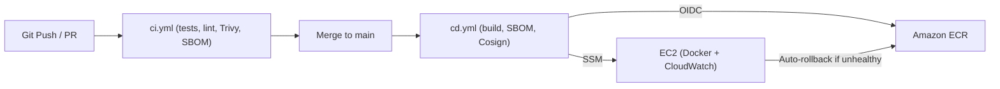
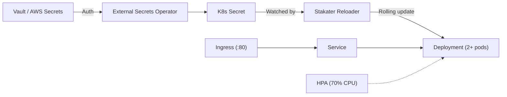
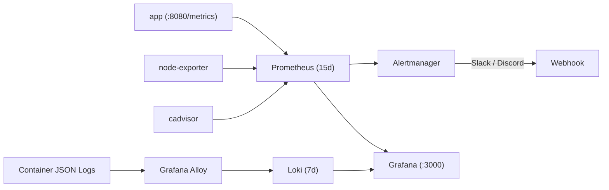
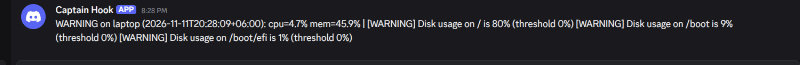
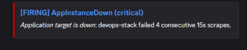
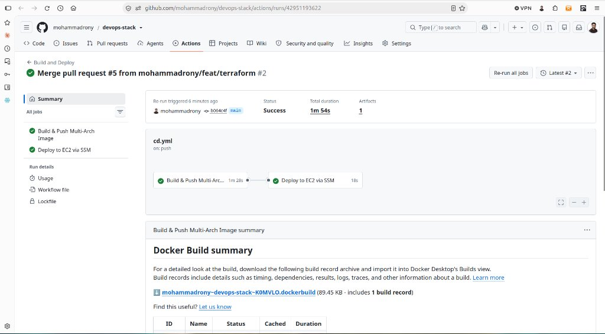
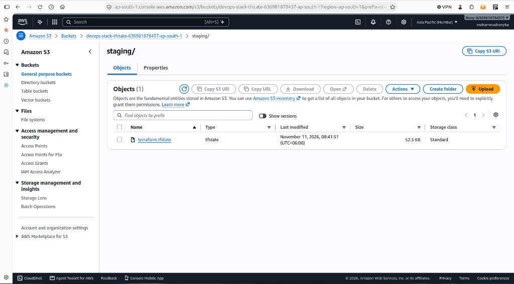
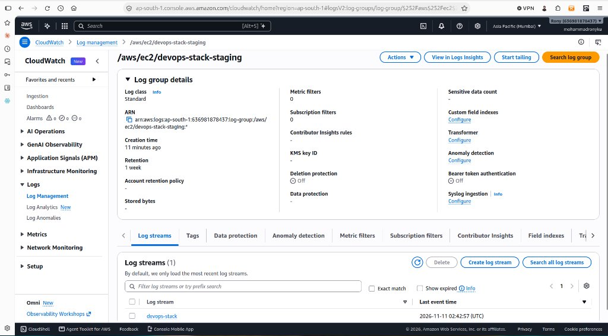

# devops-stack

Go web service (`/`, `/health`, `/metrics`) with Docker, Prometheus/Loki/Grafana monitoring with webhook alerts, CI/CD pipelines, AWS Terraform modules, Kubernetes/Helm manifests, and Ansible host setup.

## Architecture

### CI/CD & AWS EC2



### Kubernetes & Secrets



### Local Monitoring & Alerts



## Prerequisites

- Docker & Docker Compose v2 (linters run in containers via [Makefile](Makefile))
- Go 1.27+ and Trivy for `make test` and local `make lint`
- Terraform >= 1.11 and AWS CLI for [terraform/](terraform/)
- `kubectl`, `helm`, and `k3d` for [scripts/k8s_local.sh](scripts/k8s_local.sh)
- Ansible if running [ansible/playbook.yml](ansible/playbook.yml)

## Step-by-Step Verification

### 1. App, Container & Tests

Run unit tests and all linters:

```bash
make test
make lint
make lint-ansible
```

Build and test the **20.2 MB** non-root distroless container (`UID 65532`):

```bash
docker compose up -d --build
curl -s http://localhost:8080/
curl -s http://localhost:8080/health
curl -s http://localhost:8080/metrics | head -n 15
docker compose down
```

<details>
<summary>Environment variables & HTTP endpoints</summary>

| Variable | Default | Purpose |
| :--- | :--- | :--- |
| `PORT` | `8080` | HTTP listen port |
| `LOG_LEVEL` | `info` | `debug`, `info`, `warn`, or `error` |
| `APP_ENV` | `local` | Environment label in JSON logs |
| `APP_VERSION` | `0.1.0` | Version returned by `GET /` |
| `SHUTDOWN_DELAY` | `0s` | Wait window on shutdown (`/health` returns `503`) |
| `GRAFANA_ADMIN_USER` / `GRAFANA_ADMIN_PASSWORD` | `admin` / — | Grafana login in `.env` |
| `ALERT_WEBHOOK_URL` | — | Optional Slack/Discord webhook URL for Alertmanager |
| `ALERTMANAGER_EXTERNAL_URL` | `http://localhost:9093` | Base URL in alert links (set your domain in production) |
| `HEALTH_WEBHOOK_URL` | — | Optional Slack/Discord webhook URL for [scripts/system_health.sh](scripts/system_health.sh) |

- `GET /` → `{"message":"Hello from DevOps Task!","status":"running","version":"<app version>"}`
- `GET /health` → `200` when ready, `503` during shutdown
- `GET /metrics` → Prometheus metrics (`http_requests_total`, `http_errors_total`, `http_request_duration_seconds`)

</details>

### 2. Monitoring & Webhook Alerts

```bash
cp .env.example .env   # set GRAFANA_ADMIN_PASSWORD (and optional ALERT_WEBHOOK_URL)
make up-monitoring     # runs docker compose -f docker-compose.yml -f docker-compose.monitoring.yml up -d --build
# Open http://localhost:3000 -> Dashboards -> Application / Host / Containers
make down-monitoring
```

Only Grafana (`:3000`) opens a host port. Prometheus (`15d` retention) and Loki (`7d` retention) stay on the internal `monitoring` Docker network; Alertmanager shares `default` only so it can send Slack/Discord webhooks (no ports exposed; override `ALERTMANAGER_EXTERNAL_URL` behind HTTPS in production).

- **Log Labels**: Alloy promotes only 4 labels (`container`, `service`, `level`, `path` grouped as `/`, `/health`, `/metrics`, `/other`) so random 404 URLs do not create thousands of Loki streams. Raw `uri` and latency stay inside each JSON log line.

| Alert ([alerts.yml](monitoring/prometheus/alerts.yml)) | Rule (`for`) | Why |
| :--- | :--- | :--- |
| `AppInstanceDown` | `up == 0` (`1m`) | Misses 4 scrapes (15s each) to avoid restart noise. |
| `HighErrorRate` | Errors > `5%`, min 5 reqs (`2m`) | Minimum request count prevents low-traffic false alarms. |
| `HostDiskUsageHigh` | Root disk > `80%` (`5m`) | Leaves 20% headroom while ignoring brief build spikes. |
| `ContainerMemoryNearLimit` | Working set > `85%` (`2m`) | Warns ahead of OOM kills after short spikes settle. |

| Service | Host Access Granted | Why |
| :--- | :--- | :--- |
| `node-exporter` | `/proc`, `/sys`, `/` (`:ro`), `pid: host` | Read host CPU, memory, disk, and network stats. |
| `cadvisor` | `/`, `/sys`, `/var/lib/docker`, `/dev/disk` (`:ro`), `/dev/kmsg`, `privileged` | Read per-container CPU and memory usage from cgroups. |
| `alloy` | `/var/run/docker.sock` (`:ro`) | Discover running containers and ship JSON logs to Loki. |

**Application Dashboard**:


**Host Dashboard**:


**Containers Dashboard**:


**Troubleshooting an Error Spike**:

> *An error spike appears on the Application dashboard. How do you find the cause using these tools?*

1. Look at **Error Rate (%)** and **Request Rate (req/s)** to see the exact time window and whether errors hit `/` or `/other`.
2. Check the **Application Logs (Loki)** panel next to it using `{service="app", level=~"WARN|ERROR"} | json`.
3. Read `uri`, `status`, and `duration_ms` in the log lines to tell 404 scans apart from 5xx app errors.
4. Check the **Host** and **Containers** dashboards for high CPU, memory pressure, or full disk.

<details>
<summary>Tested Discord webhook alerts</summary>





</details>

### 3. Host Health Script & Ansible

[scripts/system_health.sh](scripts/system_health.sh) logs CPU, memory, disk, load, and top 5 memory processes, rotates logs past `1 MiB`, exits `0` (ok), `1` (warning), or `2` (critical), and sends Slack/Discord webhooks when `HEALTH_WEBHOOK_URL` is set:

```bash
./scripts/system_health.sh --help
./scripts/system_health.sh --disk 80 --cpu 90 --mem 85
./scripts/system_health.sh --json | jq .
```

The 5-minute systemd timer ([scripts/systemd/](scripts/systemd/)) or [cron job](scripts/system-health.cron) can be deployed with SSH/UFW hardening via [ansible/playbook.yml](ansible/playbook.yml):

```bash
cp ansible/inventory.ini.example ansible/inventory.ini   # set host IP & SSH user
ansible-galaxy collection install -r ansible/requirements.yml
# Optional: export HEALTH_WEBHOOK_URL="https://..." for Slack/Discord alerts
ansible-playbook -i ansible/inventory.ini ansible/playbook.yml
```

### 4. CI/CD Pipeline

Three workflows under [.github/workflows/](.github/workflows/) handle testing, image builds, and deployments:

- **[ci.yml](.github/workflows/ci.yml)** (PRs to `main`): runs Go tests, Dockerfile/shell/infra linters, Trivy security scans (fails on `CRITICAL`), creates a CycloneDX SBOM, and tests Cosign signing offline.
- **[cd.yml](.github/workflows/cd.yml)** (pushes to `main`): builds multi-arch images (`amd64`/`arm64`) tagged with `sha-<7chars>` and semver, saves an SBOM, and when `AWS_DEPLOY_ENABLED=true`, pushes to ECR via OIDC, signs with Cosign, and deploys to EC2 via SSM ([ssm_deploy.sh](scripts/ssm_deploy.sh) → [remote_deploy.sh](scripts/remote_deploy.sh)) with rollback if `/health` fails.
- **[terraform-apply.yaml](.github/workflows/terraform-apply.yaml)** (manual run): runs Terraform `plan`, `apply`, or `destroy` for `staging` or `production`.

<details>
<summary>Required GitHub repository secrets/variables & verified CD run</summary>

| Type | Name | Value |
| :--- | :--- | :--- |
| Secret | `AWS_ROLE_ARN` | OIDC IAM role ARN for `cd.yml` (`github_actions_role_arn` output) |
| Secret | `AWS_TERRAFORM_ROLE_ARN` | OIDC IAM role ARN for `terraform-apply.yaml` |
| Variable | `AWS_DEPLOY_ENABLED` | `true` (unset or `false` skips ECR push and EC2 deploy) |
| Variable | `AWS_REGION` | `ap-south-1` |
| Variable | `ECR_REPOSITORY` | `devops-stack` |
| Variable | `EC2_INSTANCE_ID` | Target EC2 instance ID (`i-...`) |
| Variable | `TF_STATE_BUCKET` | S3 remote state bucket name |



</details>

### 5. AWS Infrastructure (Terraform)

[terraform/](terraform/) sets up encrypted S3 remote state ([bootstrap/](terraform/bootstrap/)), ECR, an EC2 instance using AWS SSM + CloudWatch Logs, and the GitHub OIDC deploy role (`staging`/`production` under [environments/](terraform/environments/)):

```bash
terraform -chdir=terraform/bootstrap init && terraform -chdir=terraform/bootstrap apply
cp terraform/environments/staging.tfbackend.example terraform/environments/staging.tfbackend
terraform -chdir=terraform init -reconfigure -backend-config=environments/staging.tfbackend
terraform -chdir=terraform plan -var-file=environments/staging.tfvars
terraform -chdir=terraform apply -var-file=environments/staging.tfvars
terraform -chdir=terraform destroy -var-file=environments/staging.tfvars
```

Pass `-var="create_oidc_provider=false"` if your AWS account already has the GitHub OIDC provider. Low-cost choices (AES256 instead of paid KMS keys, no NAT Gateway) are documented in [terraform/.trivyignore.yaml](terraform/.trivyignore.yaml).

<details>
<summary>Verified S3 state lock & CloudWatch Logs screenshots</summary>





</details>

### 6. Kubernetes & Helm

The Helm chart in [charts/devops-stack/](charts/devops-stack/) syncs `API_TOKEN` from Vault (or AWS Secrets Manager/SSM) using External Secrets Operator, and Stakater Reloader triggers rolling restarts when secrets change. Plain YAML manifests are also in [k8s/](k8s/). Local setup and tests are wrapped in [scripts/k8s_local.sh](scripts/k8s_local.sh):

```bash
./scripts/k8s_local.sh up      # Start k3d + Vault/ESO/Reloader + deploy Helm chart
./scripts/k8s_local.sh demo    # Rotate Vault secret + upgrade to 0.2.0 + rollback to 0.1.0
./scripts/k8s_local.sh plain   # Test plain k8s/ YAML + kubectl rollout undo
./scripts/k8s_local.sh down    # Delete local k3d cluster
```

**In AWS (EKS)**: replace local Traefik with an AWS Load Balancer (ALB + HTTPS), point `SecretStore` to AWS Secrets Manager/SSM using an EKS IAM role (IRSA or Pod Identity), and pull pinned `sha-*` images from private ECR.

## Design Decisions

| Topic | Choice | Reason |
| :--- | :--- | :--- |
| Container image | Distroless vs Alpine | Smaller (**20.2 MB**), no shell, fewer CVEs; uses built-in `-healthcheck` and `SHUTDOWN_DELAY`. |
| AWS hosting | Single EC2 + SSM vs ECS/EKS | Keeps monthly AWS costs low (~$21.50/mo); Helm/K8s files are ready when scaling up. |
| Image tags | Git SHA (`sha-*`) vs `latest` | Every deploy matches an exact commit and makes rollbacks predictable. |
| Secrets | Vault / AWS Secrets + ESO vs plain YAML | Keeps secrets out of Git; Reloader handles restarts when secrets change. |
| Log labels | 4 fixed labels vs raw `uri` | Avoids Loki index bloat from random 404 paths; raw URLs stay in JSON logs. |

## Deployment & Rollback

Merges to `main` run [cd.yml](.github/workflows/cd.yml), build multi-arch images, save an SBOM, sign with Cosign, and deploy to EC2 over AWS SSM ([remote_deploy.sh](scripts/remote_deploy.sh)). If `/health` fails, the script restores the previous container (`PREV_IMAGE`) automatically; earlier versions can also be redeployed using their `sha-*` tag.

In Kubernetes, `RollingUpdate` keeps `maxUnavailable: 0` while waiting for `/health` readiness probes (`SHUTDOWN_DELAY=5s`). Roll back with `helm rollback devops-stack -n devops-stack` or `kubectl -n devops-stack rollout undo deployment/devops-stack`.

## Security Controls

- **Secrets**: No secrets in Git (`.env` and inventory files are gitignored); CI uses short-lived GitHub OIDC tokens; Kubernetes uses External Secrets Operator instead of static cluster tokens (`automountServiceAccountToken: false`).
- **Scans & Checks**: Go `-race` tests, `hadolint`, `shellcheck`, `actionlint`, `markdownlint`, `helm lint`, `ansible-lint`, `promtool`/`amtool`, Trivy vulnerability/config scans, CycloneDX SBOMs, and Cosign signing.
- **Containers & Host**: Containers run as non-root `65532` with `readOnlyRootFilesystem: true` and `cap_drop: ALL`; [ansible/playbook.yml](ansible/playbook.yml) disables SSH root/password login and turns on UFW (`22`, `8080`).
- **AWS & Network**: EC2 has no SSH port open (`22` closed, SSM only), uses IMDSv2 (`hop_limit = 1`), least-privilege IAM, and an internal Docker network for metrics/logs.

## Estimated AWS Monthly Cost

Estimate for running the `production` Terraform config ([production.tfvars](terraform/environments/production.tfvars)) in `ap-south-1` (Mumbai), 730 hours/month:

| Resource | Details | Est. Cost / Month |
| :--- | :--- | :--- |
| EC2 (`t3.small`) | 2 vCPU, 2 GiB RAM (`~$0.0224/hr`) | \$16.35 |
| Public IPv4 | Attached to EC2 (`~$0.005/hr`) | \$3.65 |
| EBS (`gp3`) | 10 GB encrypted disk | \$0.80 |
| CloudWatch Logs | ~1 GB/mo logs, 30-day retention | \$0.53 |
| Amazon ECR | ~1–2 GB container images | \$0.15 |
| S3 State | Terraform state + `.tflock` | \$0.02 |
| **Total (EC2)** | Single-instance setup | **~\$21.50/mo** |

Running the same app on managed HA EKS in `ap-south-1` would cost roughly **\$155–180/month** because of the EKS control plane (\$73), multi-node EC2 (~2× `t3.small`, \$32.70), an ALB (~\$18), and NAT Gateway(s) (~\$33+).

## What I Would Improve With More Time

1. Add HTTPS in front of EC2 (with Caddy or an AWS Load Balancer) and move the server into a private subnet without a public IP.
2. Deploy Prometheus and Grafana inside Kubernetes (`kube-prometheus-stack`) instead of only running them locally with Docker Compose.
3. Add manual deployment approvals for `production` in GitHub Actions and automated post-deploy smoke checks in staging.

## AI Tooling Note

An AI coding assistant helped draft parts of the Go code, Terraform modules, Helm/Vault configs, Ansible playbook, and documentation. I reviewed, edited, and ran all tests, scripts, and pipelines myself.
